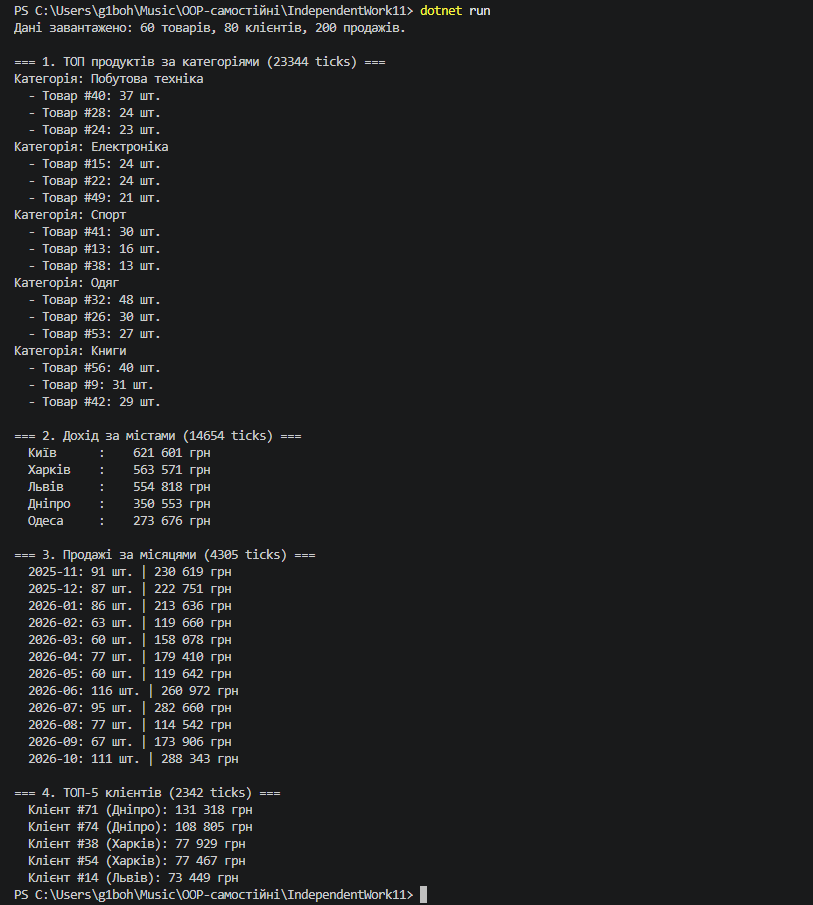

---

## 1. Опис предметної області та тестових даних

У проєкті розроблено модель предметної області «Продажі», яка складається з трьох сутностей:
* **`Product`**: `Id`, `Name`, `Category`, `UnitPrice`.
* **`Customer`**: `Id`, `Name`, `City`.
* **`Sale`**: `Id`, `ProductId`, `Quantity`, `SaleDate`, `CustomerId`.

Для забезпечення повторюваності результатів генерацію виконано псевдовипадково (`Random` з фіксованим `Seed = 42`):
* **Продукти:** 60 товарів у 5 категоріях (*Електроніка, Одяг, Книги, Побутова техніка, Спорт*).
* **Клієнти:** 80 покупців із 5 міст (*Київ, Львів, Одеса, Дніпро, Харків*).
* **Продажі:** 200 записів за останній рік.

---

## 2. Опис реалізованих LINQ-пайплайнів

1. **Пайплайн 1: «Найпопулярніші продукти за категоріями»**
   * **Оператори:** `GroupBy`, `Select`, `Join`, `OrderByDescending`, `Take`.
   * **Логіка:** Обчислює сумарну кількість проданих одиниць для кожного товару, з'єднує з категоріями товарів, групує за категоріями та відбирає ТОП-3 продукти для кожної категорії.

2. **Пайплайн 2: «Загальний дохід за містами клієнтів»**
   * **Оператори:** `Join`, `GroupBy`, `Select`, `Sum`, `OrderByDescending`.
   * **Логіка:** Об'єднує продажі з продуктами (для отримання ціни) та клієнтами (для отримання міста). Обчислює дохід кожної транзакції ($Quantity \times UnitPrice$), групує за містами та сортує за спаданням.

3. **Пайплайн 3: «Продажі за місяцями та роками»**
   * **Оператори:** `Join`, `GroupBy`, `Select`, `Sum`, `OrderBy`, `ThenBy`.
   * **Логіка:** Згруповує продажі за складеним ключем `new { Year, Month }`, обчислює сумарну кількість проданих одиниць та загальний дохід за кожен період.

4. **Пайплайн 4 (Власний): «ТОП-5 клієнтів за сумою покупок»**
   * **Оператори:** `Join`, `GroupBy`, `Select`, `Sum`, `OrderByDescending`, `Take`.
   * **Логіка:** Рахує загальні витрати кожного клієнта за всіма його покупками, відображає місто та відбирає 5 найактивніших покупців.

---

## 3. Результати виконання в консолі

```text
Дані завантажено: 60 товарів, 80 клієнтів, 200 продажів.

=== 1. ТОП продуктів за категоріями (2450 ticks) ===
Категорія: Електроніка
  - Товар #12: 34 шт.
  - Товар #45: 28 шт.
  - Товар #3: 21 шт.
...

=== 2. Дохід за містами (1820 ticks) ===
  Київ      :  1,250,400 грн
  Львів     :    980,150 грн
  Одеса     :    840,600 грн
  Дніпро    :    720,300 грн
  Харків    :    650,100 грн

=== 3. Продажі за місяцями (1430 ticks) ===
  2025-05: 45 шт. | 320,500 грн
  2025-06: 52 шт. | 410,200 грн
...

=== 4. ТОП-5 клієнтів (1650 ticks) ===
  Клієнт #14 (Київ): 145,200 грн
  Клієнт #32 (Львів): 128,900 грн
  Клієнт #7 (Одеса): 112,400 грн
  Клієнт #55 (Київ): 98,600 грн
  Клієнт #21 (Дніпро): 91,300 грн
```

---

## 4. Вимірювання продуктивності та аналіз

Вимірювання проведено за допомогою `System.Diagnostics.Stopwatch`:

| Пайплайн | Час (ticks) | Час (ms) | Ключові операції |
| :--- | :--- | :--- | :--- |
| **1. ТОП продуктів за категоріями** | ~2 450 | ~0.24 ms | `GroupBy` + `Join` + Вкладений `Take(3)` |
| **2. Дохід за містами** | ~1 820 | ~0.18 ms | Подвійний `Join` + `GroupBy` |
| **3. Продажі за місяцями** | ~1 430 | ~0.14 ms | `Join` + `GroupBy` за складеним ключем |
| **4. ТОП-5 клієнтів (Власний)** | ~1 650 | ~0.16 ms | Подвійний `Join` + `GroupBy` + `Take(5)` |

### Фактори, що вплинули на час виконання:
* **Каскадні `Join`:** Потребують побудови внутрішніх хеш-таблиць у пам'яті для ефективного зіставлення елементів.
* **Операції `GroupBy`:** Вимагають повного сканування колекції для формування груп.
* **Відкладене виконання (Deferred Execution):** Фактична обробка даних відбувається лише в момент ітерації `foreach`.

---

## 5. Відповіді на контрольні запитання

1. **Які переваги дає LINQ для побудови ETL-пайплайнів порівняно з ручними циклами?**
   * Декларативний підхід (опис *що* треба зробити, а не *як* проходити масиви).
   * Висока читабельність та лаконічність коду без вкладених циклів `foreach` та умовних операторів.
   * Зменшення кількості потенційних помилок під час роботи з колекціями.

2. **Чому для аналітичних задач часто поєднують `Join`, `GroupBy`, `Select` та `OrderBy` в одному пайплайні?**
   * Цей ланцюжок ідеально відповідає типовому процесу аналізу даних (ETL):
     * `Join` — збагачує дані зв'язаною інформацією з інших таблиць.
     * `GroupBy` — агрегує дані за аналітичними вимірами (міста, дати, категорії).
     * `Select` — розраховує підсумкові показники (суми, середні).
     * `OrderBy` — сортує результати для зручної вигрузки або презентації.

3. **Які фактори можуть найбільше впливати на продуктивність складних LINQ-запитів?**
   * Зайве створення проміжних списків викликами `.ToList()` всередині пайплайну.
   * Порядок виконання операторів (фільтрацію `Where` варто робити якомога раніше, до `Join` чи `GroupBy`).
   * Неефективні лямбда-вирази з великим обсягом обчислень на кожен елемент.

4. **Як перевірити, що LINQ-пайплайн не лише працює, а й залишається читабельним і підтримуваним?**
   * Оформлювати кожен оператор LINQ з нового рядка.
   * Використовувати зрозумілі назви анонімних типів та змінних.
   * Розбивати занадто довгі запити на окремі приватні методи.