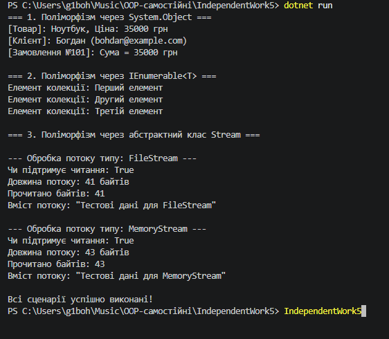

## 1. Дослідження поліморфізму через базовий клас `Object`

Усі класи в C# неявно успадковуються від базового класу `System.Object`. Це дає змогу використовувати такі віртуальні методи, як `ToString()`, `Equals()`, `GetHashCode()`, та перевизначати їх у власних класах.

### Фрагмент коду:
```csharp
List<object> objects = new List<object>
{
    new Product("Ноутбук", 35000m),
    new Customer("Богдан", "bohdan@example.com"),
    new Order(101, 35000m)
};

foreach (object obj in objects)
{
    Console.WriteLine(obj.ToString());
}
```

### Прояв поліморфізму та переваги:
* **Як проявляється:** Колекція `List<object>` зберігає об'єкти різних типів за посиланням на базовий тип `object`. При виклику `obj.ToString()` C# під час виконання визначає реальний тип об'єкта та викликає відповідний перевизначений метод `ToString()`.
* **Переваги:** Забезпечує уніфіковану обробку та виведення інформації про будь-які об'єкти без необхідності знати їхній точний тип.

---

## 2. Дослідження поліморфізму через інтерфейс `IEnumerable`

Багато колекцій у .NET реалізують інтерфейс `IEnumerable` або `IEnumerable<T>`, що дозволяє перебирати їхні елементи за допомогою циклу `foreach`.

### Фрагмент коду:
```csharp
public class MyCustomCollection : IEnumerable<string>
{
    private readonly List<string> _items = new List<string>();

    public void Add(string item) => _items.Add(item);

    public IEnumerator<string> GetEnumerator() => _items.GetEnumerator();
    IEnumerator IEnumerable.GetEnumerator() => GetEnumerator();
}

// Використання
MyCustomCollection myCollection = new MyCustomCollection
{
    "Перший елемент",
    "Другий елемент",
    "Третій елемент"
};

foreach (string item in myCollection)
{
    Console.WriteLine($"Елемент колекції: {item}");
}
```

### Прояв поліморфізму та переваги:
* **Як проявляється:** Конструкція `foreach` працює через стандартний інтерфейс `IEnumerable<T>`, викликаючи метод `GetEnumerator()`, незалежно від внутрішньої структури колекції.
* **Переваги:** Сховує внутрішній устрій збереження даних і дозволяє клієнтському коду обходити власні колекції так само легко, як і звичайні масиви або `List<T>`.

---

## 3. Дослідження поліморфізму через абстрактний клас `Stream`

Абстрактний клас `System.IO.Stream` виступає єдиним контрактом для роботи з різними джерелами даних (файли, оперативна пам'ять, мережа тощо).

### Фрагмент коду:
```csharp
public static void ProcessStream(Stream stream)
{
    Console.WriteLine($"\n--- Обробка потоку типу: {stream.GetType().Name} ---");
    byte[] buffer = new byte[stream.Length];
    int bytesRead = stream.Read(buffer, 0, buffer.Length);
    string content = Encoding.UTF8.GetString(buffer, 0, bytesRead);
    Console.WriteLine($"Вміст потоку: \"{content}\"");
}

// Виклик для FileStream та MemoryStream
using (FileStream fileStream = File.OpenRead("test_file.txt"))
{
    ProcessStream(fileStream);
}

using (MemoryStream memoryStream = new MemoryStream(memoryData))
{
    ProcessStream(memoryStream);
}
```

### Прояв поліморфізму та переваги:
* **Як проявляється:** Метод `ProcessStream` приймає абстрактний тип `Stream`. Реальний виклик методу `Read()` делегується конкретній реалізації (`FileStream` чи `MemoryStream`).
* **Переваги:** Повторне використання коду та гнучкість — один і той самий метод працює з будь-яким потоком даних без створення окремих перевантажень під кожен тип.

---

## 4. Відповіді на контрольні запитання

1. **Як поліморфізм проявляється при роботі з `List<object>`?**
   Об'єкти різних типів зберігаються в єдиній колекції за базовим типом `object`. При виклику віртуальних методів (наприклад, `ToString()`) середовище виконання CLR динамічно викликає реалізацію конкретного похідного класу.

2. **Що потрібно реалізувати в `MyCustomCollection`, щоб її можна було перебирати через `foreach`?**
   Необхідно реалізувати інтерфейс `IEnumerable<T>` (або `IEnumerable`) та його метод `GetEnumerator()`, який повертає ітератор `IEnumerator`.

3. **Чому метод `ProcessStream(Stream stream)` є прикладом поліморфної роботи з абстрактним класом?**
   Метод приймає параметр абстрактного базового класу `Stream`. Це дозволяє передавати в нього екземпляри будь-яких підкласів (`FileStream`, `MemoryStream`, `NetworkStream`) і працювати з ними через спільний інтерфейс.

4. **Які переваги дає єдиний інтерфейс роботи для різних типів потоків і колекцій?**
   Забезпечує високу гнучкість, спрощує розширення системи новими типами потоків або колекцій, заперечує дублювання коду та робить програму незалежною від конкретних деталей реалізації.