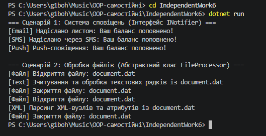

---

## Сценарій 1: Система сповіщень

### Обраний підхід: Інтерфейс `INotifier`

### Обґрунтування вибору:
У цьому сценарії найкраще використовувати інтерфейс `INotifier`, оскільки:
1. **Різні базові типи:** Класи `EmailNotifier`, `SmsNotifier`, `PushNotifier` можуть не мати спільної ієрархії успадкування чи спільного стану. Вони реалізують лише єдину поведінку — відправку повідомлення.
2. **Множинна поведінка:** Інтерфейс дозволяє будь-якому існуючому класу (наприклад, `UserAccount` чи `SystemLogger`) додатково реалізувати контракт сповіщувача без прив'язки до єдиного базового класу.
3. **Слабке зв'язування:** Клієнтський код залежить лише від контракту `Send(string message)`, що дозволяє легко додавати нові канали сповіщень (наприклад, TelegramNotifier) без зміни існуючої системи.

### Реалізація:
```csharp
public interface INotifier
{
    void Send(string message);
}

public class EmailNotifier : INotifier
{
    public void Send(string message)
    {
        Console.WriteLine($"[Email] Надіслано листом: {message}");
    }
}

public class SmsNotifier : INotifier
{
    public void Send(string message)
    {
        Console.WriteLine($"[SMS] Надіслано через SMS: {message}");
    }
}

public class PushNotifier : INotifier
{
    public void Send(string message)
    {
        Console.WriteLine($"[Push] Push-сповіщення: {message}");
    }
}
```

---

## Сценарій 2: Обробка файлів

### Обраний підхід: Абстрактний клас `FileProcessor`

### Обґрунтування вибору:
У цьому сценарії доцільно обрати абстрактний клас `FileProcessor`, оскільки:
1. **Повторне використання коду:** Операції відкриття (`OpenFile`) та закриття (`CloseFile`) файлу є абсолютно однаковими для всіх обробників. Абстрактний клас дозволяє реалізувати цей спільний код один раз у базовому класі.
2. **Шаблонний метод (Template Method):** Метод `Process` задає чіткий та незмінний алгоритм обробки (відкрити -> обробити -> закрити), делегуючи похідним класам лише унікальну логіку зчитування вмісту (`ProcessContent`).
3. **Зв'язок "Is-A":** Усі конкретні обробники (`TextFileProcessor`, `XmlFileProcessor`) є безпосередньо різновидами обробника файлів.

### Реалізація:
```csharp
public abstract class FileProcessor
{
    public void Process(string filePath)
    {
        OpenFile(filePath);
        ProcessContent(filePath);
        CloseFile(filePath);
    }

    protected void OpenFile(string filePath)
    {
        Console.WriteLine($"[Файл] Відкриття файлу: {filePath}");
    }

    protected abstract void ProcessContent(string filePath);

    protected void CloseFile(string filePath)
    {
        Console.WriteLine($"[Файл] Закриття файлу: {filePath}");
    }
}

public class TextFileProcessor : FileProcessor
{
    protected override void ProcessContent(string filePath)
    {
        Console.WriteLine($"[Text] Зчитування та обробка текстових рядків із {filePath}");
    }
}

public class XmlFileProcessor : FileProcessor
{
    protected override void ProcessContent(string filePath)
    {
        Console.WriteLine($"[XML] Парсинг XML-вузлів та атрибутів із {filePath}");
    }
}
```

---

## Загальні висновки

1. **Коли використовувати Інтерфейси:**
   * Коли потрібно об'єднати спільним контрактом непов'язані класи.
   * Коли відсутня потреба у повторному використанні готового коду чи збереженні стану.
   * Коли класу необхідно реалізувати кілька різних ролей (множинне успадкування поведінки).

2. **Коли використовувати Абстрактні класи:**
   * Коли між класами є чітка ієрархічна залежність ("Is-A").
   * Коли є спільний код або спільний стан (поля, властивості), який варто реалізувати один раз у базовому класі.
   * Коли реалізується паттерн "Шаблонний метод", який визначає загальну структуру алгоритму.

---

## Відповіді на контрольні запитання

1. **Які ознаки підказують, що сценарій краще моделювати через інтерфейс?**
   Відсутність спільного стану, необхідність надати однакову поведінку непов'язаним класам та потреба у реалізації декількох контрактів одним класом.

2. **У чому перевага абстрактного класу для процесів зі спільними кроками виконання?**
   Дозволяє реалізувати алгоритм "Шаблонний метод", де спільна послідовність дій пишється один раз у базовому класі, уникнувши дублювання коду в похідних класах.

3. **Як порівняння двох підходів допомагає прийняти архітектурне рішення?**
   Допомагає обрати оптимальний баланс між повторним використанням коду (абстрактний клас) та гнучкістю і слабким зв'язуванням системи (інтерфейс).

4. **Яку роль у ваших прикладах відіграє поліморфізм?**
   Дозволяє опрацьовувати об'єкти різних конкретних типів через єдину колекцію базового типу (`List<INotifier>` та `List<FileProcessor>`), викликаючи їхні специфічні методи через спільний інтерфейс або базовий клас.