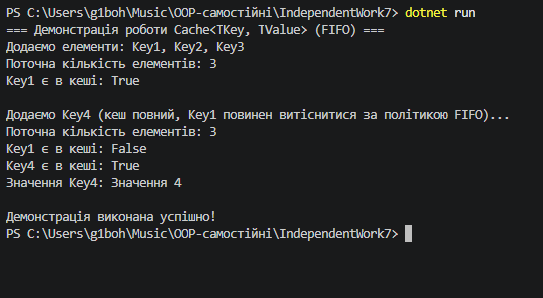
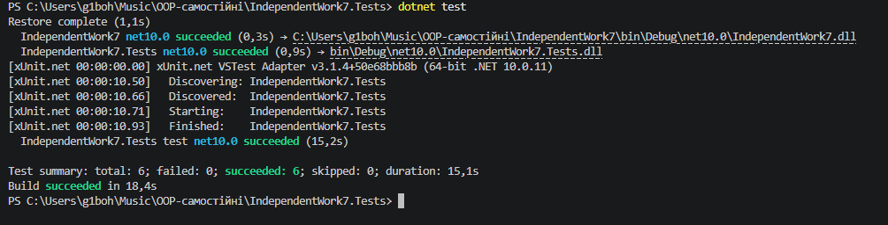

**Тема:** Узагальнений кеш `Cache<TKey, TValue>` із тестами

---

## 1. Опис реалізації `Cache<TKey, TValue>`

У проєкті реалізовано узагальнений клас кешу `Cache<TKey, TValue>` із обмеженою ємністю та політикою видалення найстаріших елементів FIFO (First In, First Out).

### Структура класу:
* **Поля:**
  * `_capacity` (`int`) — максимальна ємність кешу.
  * `_cache` (`Dictionary<TKey, TValue>`) — швидкий доступ до елементів за ключем.
  * `_keysOrder` (`Queue<TKey>`) — відстеження хронології додавання ключів для витіснення найстарішого.
* **Методи:**
  * `Add(TKey key, TValue value)` — додає елемент. Якщо досягнуто ємності, вилучає найстаріший ключ з черги та словника.
  * `Get(TKey key)` — повертає значення за ключем або викидає `KeyNotFoundException`.
  * `ContainsKey(TKey key)` — перевіряє наявність ключа.
  * `Count` — властивість для отримання поточної кількості елементів.

---

## 2. Результати юніт-тестування (`IndependentWork7.Tests`)

Проєкт покритий юніт-тестами на фреймворку **xUnit**. Тести перевіряють:
1. Додавання та отримання елементів (`AddAndGet_ValidElement_ReturnsCorrectValue`).
2. Роботу методу `ContainsKey` (`ContainsKey_CheckPresence_ReturnsExpectedBool`).
3. Точність властивості `Count` (`Count_CheckProperty_ReturnsCorrectItemCount`).
4. Генерацію винятку `KeyNotFoundException` при відсутності ключа (`Get_NonExistingKey_ThrowsKeyNotFoundException`).
5. Витіснення найстарішого елемента за політикою FIFO (`Add_CapacityExceeded_EvictsOldestElementFifo`).
6. Оновлення значення для існуючого ключа без збільшення розміру (`Add_ExistingKey_UpdatesValueWithoutEviction`).

Усі 6 тестів успішно проходять командами `dotnet test`.

---

## Відповіді на контрольні запитання

1. **Які переваги надає `Cache<TKey, TValue>` порівняно з окремими неузагальненими реалізаціями кешу?**
   * **Строга типізація (Type Safety):** Виявляє помилки невідповідності типів на етапі компіляції.
   * **Продуктивність:** Відсутність операцій упакування/розпакування (boxing/unboxing) для значущих типів (Value Types).
   * **Повторне використання коду:** Один клас працює з будь-якими типами даних без написання окремих реалізацій.

2. **Чому для реалізації політики FIFO зручно поєднувати `Dictionary<TKey, TValue>` з `Queue<TKey>` або `LinkedList<TKey>`?**
   * `Dictionary` надає миттєвий пошук та вилучення за ключем.
   * `Queue` фіксує хронологічний порядок додавання елементів, що дозволяє миттєво знаходити та видаляти найстаріший елемент без повного перебору кешу.

3. **У яких випадках метод `Get` повинен викидати `KeyNotFoundException`, а коли доцільніше використовувати підхід на кшталт `TryGetValue`?**
   * `KeyNotFoundException` доцільно викидати, коли за логікою програми відсутність ключа є винятковою та критичною помилкою.
   * `TryGetValue` є кращим підходом, коли відсутність елемента в кеші є очікуваним сценарієм (cache miss), щоб уникнути витрат ресурсів на обробку винятків.

4. **Які тести є критично важливими для перевірки політики витіснення елементів з кешу?**
   * Тест на перевищення ємності (`CapacityExceeded`): додавання $N+1$ елементів у кеш розміром $N$ і перевірка, що саме найперший елемент видалився, а розмір не перевищує $N$.
   * Тест на повторне додавання існуючого ключа: перевірка, що оновлення значення ключа не витісняє інші елементи помилково.