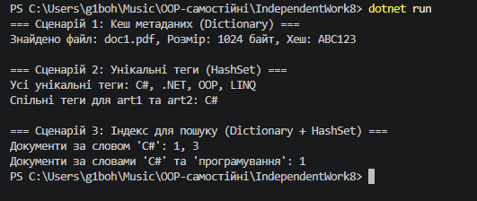

---

## Частина 1: Аналіз використання у відкритих проєктах

### 1. Використання `Dictionary<TKey, TValue>`
* **Проєкт:** Newtonsoft.Json (Json.NET)
* **Контекст:** Використання внутрішніх кешів для типів та їхніх метаданих у класі `DefaultContractResolver`.
* **Чому обрано цієї колекції:** При десеріалізації об'єктів Newtonsoft.Json повторно звертається до метаданих C#-класів (властивості, атрибути, конструктори). Збереження метаданих у `Dictionary<Type, JsonContract>` дозволяє уникнути повторного виконання повільних рефлексивних операцій.
* **Складність операцій:** Пошук за типом $O(1)$ у середньому.
* **Особливі вимоги:** Для гарантування точності та швидкості порівняння ключів викоритовуються стандартні хеш-коди типів.

### 2. Використання `HashSet<T>`
* **Проєкт:** AutoMapper
* **Контекст:** Відстеження перевірених або вже змаппених типів під час валідації конфігурації маппінгу та забігання циклічним посиланням.
* **Чому обрано цієї колекції:** Необхідна лише перевірка унікальності типів чи властивостей без збереження паралельного значення. `HashSet<T>` запобігає зацикленню алгоритму обходу графа об'єктів.
* **Складність операцій:** Перевірка та додавання `Contains` / `Add` мають складність $O(1)$.
* **Особливі вимоги:** Реалізація унікальності об'єктів `TypePair` за допомогою `IEqualityComparer<TypePair>`.

### 3. Комбіноване використання (`Dictionary<TKey, HashSet<T>>`)
* **Проєкт:** Entity Framework Core (EF Core)
* **Контекст:** Побудова графа залежностей між сутностями метамоделі (`IModel`) для визначення порядку виконання інсертів та делітів в БД.
* **Чому обрано цієї комбінації:** `Dictionary` забезпечує доступ до ключа сутності за $O(1)$, а `HashSet` зберігає унікальну множину пов'язаних ключів залежностей без дублювання.
* **Складність операцій:** Пошук сутності $O(1)$, додавання унікальної залежності $O(1)$, об'єднання/перетин множин залежностей $O(N)$.

---

## Частина 2: Практична реалізація

У проєкті `IndependentWork8` реалізовано 3 сценарії:
1. `FileMetadataCache` — використання `Dictionary<string, FileMetadata>` з `StringComparer.OrdinalIgnoreCase` для кешування файлових метаданих за іменем.
2. `TagManager` — використання `Dictionary<string, HashSet<string>>` для збереження унікальних тегів статей блогу та виконання операцій `UnionWith` і `IntersectWith`.
3. `SearchIndex` — інвертований пошуковий індекс `Dictionary<string, HashSet<int>>`, що розбиває текст на слова та виконує пошук документів за збігом слів.

---

## Частина 3: Порівняльна таблиця складності операцій

| Операція | List\<T\> | Dictionary\<TKey, TValue\> | HashSet\<T\> | Коли використовувати |
|---|---|---|---|---|
| **Додавання** | $O(1)$ у кінець / $O(n)$ в середину | $O(1)$ у середньому | $O(1)$ у середньому | `List` — впорядкований список; `Dictionary`/`HashSet` — унікальні ключі чи елементи. |
| **Пошук за значенням** | $O(n)$ | $O(n)$ | $O(1)$ | `HashSet` для миттєвої перевірки наявності елемента у множині. |
| **Пошук за ключем** | N/A | $O(1)$ | N/A | `Dictionary` для миттєвого доступу до значення за ідентифікатором. |
| **Видалення** | $O(n)$ | $O(1)$ | $O(1)$ | `Dictionary`/`HashSet` для швидкого видалення елементів без зсуву масиву. |
| **Перевірка наявності** | $O(n)$ | $O(1)$ (по ключу) / $O(n)$ (по значенню) | $O(1)$ | `HashSet` або `Dictionary.ContainsKey`. |

---

## Частина 4: Висновки та відповіді на контрольні запитання

1. **Які переваги generic-колекцій над неузагальненими структурами даних у .NET?**
   * **Строга типізація (Type Safety):** Виявляє помилки невідповідності типів на етапі компіляції.
   * **Продуктивність:** Відсутність операцій упакування/розпакування (boxing/unboxing) для значущих типів (Value Types).
   * **Чистота коду:** Немає потреби у примусовому приведенні типів (`(Type)obj`).

2. **У яких сценаріях доцільніше використовувати `Dictionary<TKey, TValue>`, а в яких `HashSet<T>`?**
   * `Dictionary<TKey, TValue>` доцільно використовувати, коли є прив'язка "ключ-значення" і необхідний швидкий пошук об'єкта за його унікальним ідентифікатором.
   * `HashSet<T>` є оптимальним, коли важлива лише множина унікальних елементів без пар "значення" та потрібні високопродуктивні математичні операції над множинами (перетин, об'єднання, різниця).

3. **Як `IEqualityComparer<T>` впливає на коректність і продуктивність Dictionary та HashSet?**
   * `IEqualityComparer<T>` визначає обчислення хеш-коду (`GetHashCode`) та перевірку рівності (`Equals`).
   * **Продуктивність:** Рівномірний розподіл хеш-кодів мінімізує колізії в бакетах і зберігає швидкість $O(1)$.
   * **Коректність:** Дозволяє налаштовувати порівняння без урахування регістру (`StringComparer.OrdinalIgnoreCase`) або порівнювати складні об'єкти за окремими полями.

4. **Чому інвертований індекс зручно будувати саме на базі `Dictionary<string, HashSet<int>>`?**
   * `Dictionary` забезпечує пошук терміна (слова) за $O(1)$.
   * `HashSet<int>` гарантує унікальність ID документів і дозволяє швидко знаходити перетин документів (`IntersectWith`) при пошуку за кількома словами одночасно.
