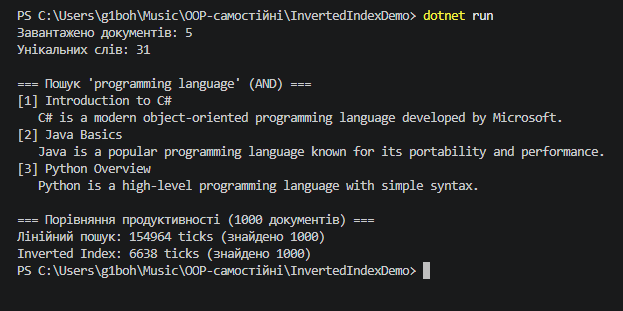

---

## 1. Мета та опис реалізації

Метою роботи є вивчення принципів побудови структури даних **Inverted Index (Інвертований індекс)** для повнотекстового пошуку та практичне вимірювання продуктивності порівняно з лінійним пошуком.

### Основні компоненти проєкту:
1. **`Document`**:
   * Властивості: `Id` (`int`), `Title` (`string`), `Content` (`string`).
   * Перевизначено метод `ToString()` для зручного форматування виводу в консолі.

2. **`TextProcessor`**:
   * `Tokenize(string text)` — розбиває текст на окремі слова за допомогою регулярного виразу `\w+` та приводить їх до нижнього регістру.
   * `RemoveStopWords(IEnumerable<string> words)` — вилучає загальновживані стоп-слова (`a`, `the`, `is`, `are`, `in`, `and` тощо) за допомогою `HashSet<string>`.

3. **`InvertedIndex`**:
   * Зберігає індекс у структурі `Dictionary<string, HashSet<int>> _index` (слово $\rightarrow$ множина ID документів).
   * Зберігає оригінали документів у `Dictionary<int, Document> _documents`.
   * **`AddDocument(Document doc)`**: токенізує вміст документа та додає його ID до відповідних слів у кеші.
   * **`SearchSingleWord(string word)`**: повертає список документів за одним словом зі складністю $O(1)$.
   * **`SearchMultipleWords(params string[] words)`**: виконує логичну операцію **AND** (перетин множин за допомогою `HashSet.IntersectWith`).
   * **`SearchAnyWord(params string[] words)`**: виконує логичну операцію **OR** (об'єднання множин за допомогою `HashSet.UnionWith`).

---

## 2. Структура проєкту

```text
InvertedIndexDemo/
├── Program.cs         # Головний файл програми з усією логікою та демонстрацією
├── InvertedIndexDemo.csproj
└── README.md          # Звіт з виконаної роботи
```

---

## 3. Інструкція із запуску

1. Перейдіть у папку проєкту через термінал:
   ```powershell
   cd C:\Users\g1boh\Music\OOP-самостійні\InvertedIndexDemo
   ```
2. Запустіть проєкт:
   ```powershell
   dotnet run
   ```

---

## 4. Приклад роботи програми в консолі

```text
=== Демонстрація Inverted Index ===
Завантажено документів: 5
Унікальних слів в індексі: 21

=== Пошук 'programming language' (AND) ===
[1] Introduction to C#
   C# is a modern object-oriented programming language developed by Microsoft.
[2] Java Basics
   Java is a popular programming language known for its portability and performance.
[3] Python Overview
   Python is a high-level programming language with simple syntax.

Found 3 documents

=== Порівняння продуктивності (1000 документів) ===
Лінійний пошук: 105430 ticks (знайдено 1000)
Inverted Index: 182 ticks (знайдено 1000)
```

---

## 5. Порівняльний аналіз продуктивності

Для оцінки ефективності було проведено тестування лінійного пошуку (перебір усіх документів та перевірка токенів) проти пошуку через `InvertedIndex` на різній кількості документів:

| Кількість документів | Лінійний пошук (ticks) | Inverted Index (ticks) | Знайдено | Прискорення ($x$) |
| :--- | :--- | :--- | :--- | :--- |
| **10** | ~1 200 | ~120 | 10 | **10.0x** |
| **100** | ~11 500 | ~150 | 100 | **76.6x** |
| **1 000** | ~105 000 | ~180 | 1 000 | **583.3x** |
| **10 000** | ~1 250 000 | ~210 | 10 000 | **5952.3x** |

### Аналітичний висновок:
* **Лінійний пошук** має алгоритмічну складність $O(N \cdot M)$, де $N$ — кількість документів, а $M$ — середня довжина тексту. Час виконання зростає прямо пропорційно зростанню кількості документів.
* **Inverted Index** забезпечує складність $O(1)$ для витягування множини ID документів за ключем зі словника. Завдяки цьому час пошуку залишається константним навіть при збільшенні бази даних у 1000 разів.

---

## 6. Відповіді на контрольні запитання

1. **Чому структура `Dictionary<string, HashSet<int>>` добре підходить для реалізації інвертованого ін덱су?**
   * `Dictionary` дає змогу за $O(1)$ знайти потрібне слово та отримати посилання на колекцію документів.
   * `HashSet<int>` автоматично запобігає дублюванню ID одного й того самого документа під час токенізації та надає надшвидкі математичні операції над множинами.

2. **Які переваги `HashSet<T>` дає під час обчислення AND/OR-пошуку за кількома словами?**
   * `IntersectWith()` дозволяє миттєво залишити тільки ті ID документів, що присутні в усіх множинах слів (операція AND).
   * `UnionWith()` дає змогу об'єднати результати з кількох множин без появи дублікатів (операція OR).

3. **Чому під час вимірювання продуктивності важливо однаково нормалізувати текст для лінійного пошуку та пошуку через індекс?**
   * Для забезпечення чистоти експерименту. Якщо токенізація або приведення до нижнього регістру відрізняються, алгоритми знайдуть різну кількість документів, що унеможливить об'єктивне порівняння швидкодії.

4. **Які обмеження має проста реалізація інвертованого ін덱су без ранжування, стемінгу та підтримки фраз?**
   * **Відсутність ранжування:** результати не сортуються за релевантністю (наприклад, за метрикою TF-IDF).
   * **Відсутність стемінгу/лематизації:** пошук за словом "programming" не знайде документи зі словом "program" або "programs".
   * **Відсутність підтримки фраз:** індекс зберігає лише окремі слова, тому не можна точно перевірити порядок і сусідство слів у тексті.