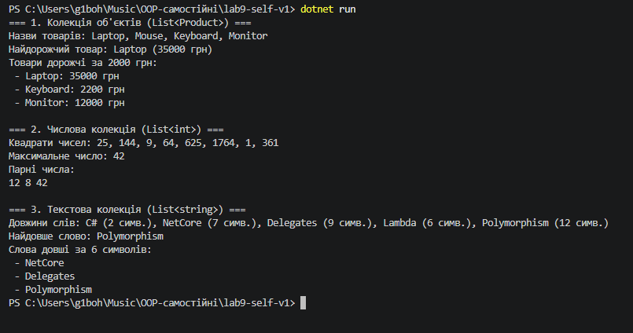

---

## 1. Опис реалізації `CollectionUtils`

У проєкті розроблено статичний клас узагальнених утиліт `CollectionUtils`, який дозволяє передавати поведінку через делегати та лямбда-вирази:

1. **`Map<TSource, TResult>`:** Перетворює кожен елемент колекції за допомогою делегата `Func<TSource, TResult>`.
2. **`MaxBy<T, TKey>`:** Знаходить елемент із максимальним значенням ключа, порівнюючи ключі через `IComparable<TKey>`.
3. **`Filter<T>`:** Фільтрує елементи за умовою `Predicate<T>`.
4. **`ForEach<T>`:** Виконує вказану дію `Action<T>` для кожного елемента колекції.

---

## 2. Результати виконання у консолі

```text
=== 1. Колекція об'єктів (List<Product>) ===
Назви товарів: Laptop, Mouse, Keyboard, Monitor
Найдорожчий товар: Laptop (35000 грн)
Товари дорожчі за 2000 грн:
 - Laptop: 35000 грн
 - Keyboard: 2200 грн
 - Monitor: 12000 грн

=== 2. Числова колекція (List<int>) ===
Квадрати чисел: 25, 144, 9, 64, 625, 1764, 1, 361
Максимальне число: 42
Парні числа:
12 8 42 

=== 3. Текстова колекція (List<string>) ===
Довжини слів: C# (2 симв.), NetCore (7 симв.), Delegates (9 симв.), Lambda (6 симв.), Polymorphism (12 симв.)
Найдовше слово: Polymorphism
Слова довші за 6 символів:
 - NetCore
 - Delegates
 - Polymorphism